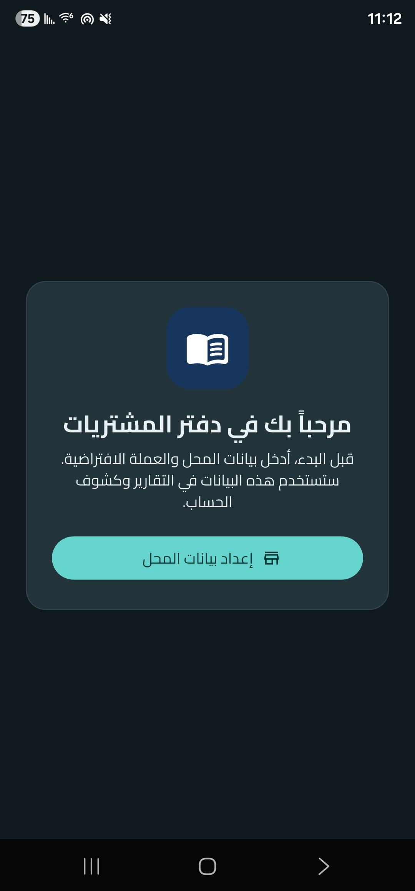
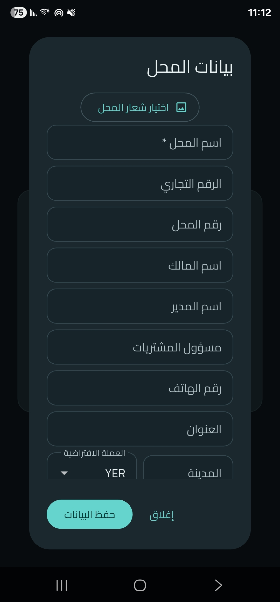
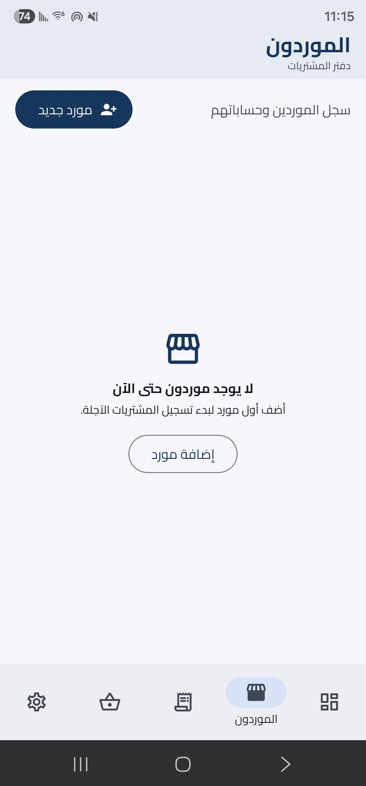
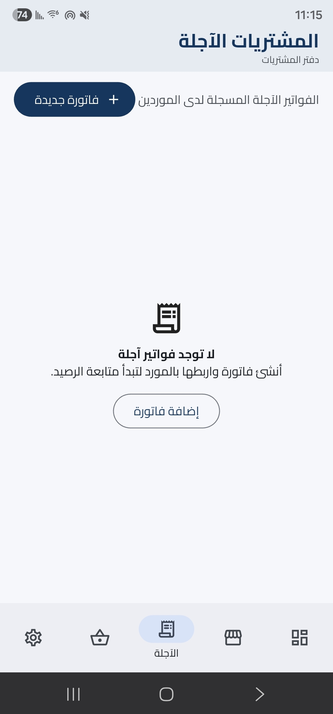
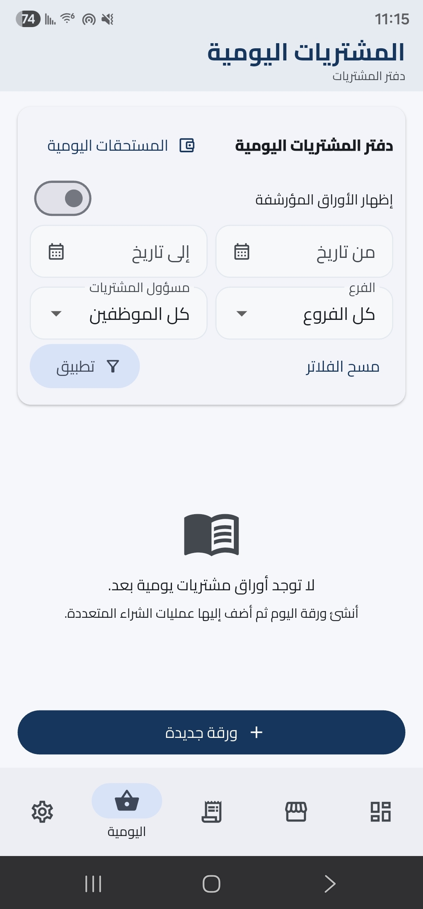

<div align="center" dir="rtl">


# Purchase Ledger

### نظام إدارة المشتريات الآجلة واليومية

تطبيق Flutter لتنظيم المشتريات وأوراق اليومية وحسابات الموردين، مع تتبّع الفواتير والمدفوعات والمستحقات وإعداد التقارير.

**Flutter · Dart · Riverpod · SQLite · Android**

**حالة المشروع: قيد التطوير والاختبار — Development / Testing**

</div>

> **English overview:** Purchase Ledger is an offline-first Flutter application for recording daily and credit purchases, tracking supplier balances and invoice payments, and producing accounting reports. This repository represents an evolving implementation; Android integration and release readiness still require verification.

## نظرة عامة | Overview

يساعد **دفتر المشتريات** المحلات والأعمال التجارية على تسجيل عمليات الشراء اليومية، ومتابعة الفواتير الآجلة للموردين، وربط الدفعات والمرتجعات والتسويات بسجلات قابلة للمراجعة. تُخزّن البيانات محليًا باستخدام SQLite، وتدعم الواجهة العربية والإنجليزية، مع أوضاع المظهر الفاتح والداكن.

لا يمثل هذا المستودع نظام تخطيط موارد مؤسسية كاملًا، ولا يُفترض أنه نظام مخزون متكامل. وظائفه الأساسية منصبّة على تسجيل المشتريات والحسابات المرتبطة بها.

## المزايا الموجودة في المصدر | Main Features

| المجال | ما يقدمه التطبيق |
| --- | --- |
| **المشتريات الآجلة** | إدخال فواتير الموردين وأصنافها، عرض التفاصيل، ومتابعة المستحقات والدفعات والمرتجعات. |
| **المشتريات اليومية** | دفتر أوراق يومية، عمليات نقدية وآجلة، حقول للفرع ومسؤول المشتريات، وحالات للورقة وتقرير لتسليمها للحسابات. |
| **الموردون** | سجل للموردين، نظرة عامة على الحساب، الفواتير والدفعات وكشف حساب بحسب العملة. |
| **الحركات المالية** | دفعات الموردين وتخصيصاتها، الأرصدة المقدّمة، التسويات والمرتجعات والعمليات العكسية ضمن القيود المتاحة. |
| **المستحقات اليومية** | متابعة المستحقات المستقلة وسجل السداد والتعديلات المرتبطة بها. |
| **التقارير** | توليد كشوف PDF وتقارير تسليم أوراق اليومية، مع إمكان الطباعة والمشاركة عبر واجهات النظام. ويتضمن المصدر خدمة تصدير CSV. |
| **إعدادات التشغيل** | بيانات المحل، والفروع، ومسؤولو المشتريات، ووحدات قياس منفصلة للمشتريات الآجلة واليومية. |
| **اللغة والمظهر** | العربية والإنجليزية، واتجاه واجهة ملائم، والوضعان الفاتح والداكن. |
| **التدقيق** | أحداث وسجلات تغييرات مالية محفوظة وفق تصميم قاعدة البيانات الحالي. |

> وجود الوظيفة في المصدر لا يعني أن جميع سيناريوهات تشغيلها على الهاتف قد اجتازت الاختبارات النهائية. اطّلع على [حالة التحقق](#حالة-التطوير-والتحقق--project-status) قبل الاعتماد المالي.

## لقطات من التطبيق | Application Screenshots

لقطات حقيقية من اختبار Android، أُخذت في الوضعين الفاتح والداكن. اختيرت هنا **خمس صور لا تُظهر أسماء الموردين أو أرقام هواتفهم أو أرصدة شخصية**؛ ولا تزال معظمها تعرض الحالة الأولية دون معاملات. أُزيلت بيانات EXIF من النسخ المنشورة. الصور لا تُستخدم لإثبات اكتمال الوظائف المحاسبية.

<table>
  <tr>
    <td align="center" width="50%">
      <br />
      <strong>الترحيب · Welcome</strong><br />
      <sub>بداية إعداد معلومات المحل اللازمة للتقارير وكشوف الحساب.</sub>
    </td>
    <td align="center" width="50%">
      <br />
      <strong>إعداد المحل · Shop Setup</strong><br />
      <sub>نموذج الاسم والبيانات الأساسية والعملة الافتراضية.</sub>
    </td>
  </tr>
  <tr>
    <td align="center">
      <br />
      <strong>سجل الموردين · Suppliers</strong><br />
      <sub>عرض قائمة الموردين وإضافة مورد جديد؛ تظهر هنا حالة القائمة الفارغة.</sub>
    </td>
    <td align="center">
      <br />
      <strong>فواتير الآجل · Credit Invoices</strong><br />
      <sub>مدخل فواتير المشتريات الآجلة وإجراء إنشاء فاتورة جديدة.</sub>
    </td>
  </tr>
  <tr>
    <td align="center">
      <br />
      <strong>دفتر اليومية · Daily Sheets</strong><br />
      <sub>الفلاتر بحسب التاريخ والفرع والمسؤول، وعرض الأوراق وإنشاؤها.</sub>
    </td>
    <td align="center">
      <strong>المزيد من الشاشات قريبًا</strong><br />
      <sub>ستضاف لقطات تفاصيل المورد والدفعات والتقارير بعد توفير بيانات عرض تجريبية آمنة للنشر.</sub>
    </td>
  </tr>
</table>

> تنبيه: لقطات الشاشات التي احتوت أسماء وأرقامًا وبيانات أعمال فعلية **لم تُدرج** في ملفات المستودع العام. راجع دليل النشر المرفق مع التسليم قبل إضافة صور أخرى.

## التقنية والبنية | Technology & Architecture

التقنيات التالية مثبتة في `pubspec.yaml` وملفات المصدر:

| التقنية | الاستخدام |
| --- | --- |
| Flutter / Dart | تطبيق Android وواجهات Material. يتطلب المصدر Dart `^3.6.0`. |
| `flutter_riverpod` | مزودات الحالة والمستودعات ومصادر البيانات. |
| `go_router` | التنقل بين شاشات التطبيق. |
| `sqflite` | التخزين المحلي والترقيات المتسلسلة لقاعدة البيانات. آخر ترقية موجودة: **V8**. |
| `intl` و`flutter_localizations` | التنسيق المحلي واللغة. |
| `pdf` و`pdf_text_shaper` و`printing` | تشكيل النص العربي، وتوليد PDF وطباعته ومشاركته. |
| `image_picker` و`share_plus` و`url_launcher` | اختيار المرفقات والمشاركة وفتح الروابط المدعومة. |

### هيكل المشروع الفعلي

```text
purchase_ledger/
├── android/               # إعدادات وتطبيق Android
├── assets/                # الأيقونة وخطوط العرض العربية
├── docs/screenshots/      # لقطات Android المختارة للنشر
├── lib/
│   ├── app/               # التوجيه ومزودات Riverpod والتطبيق
│   ├── core/              # SQLite، الحسابات، الإعدادات، التقارير، التعريب
│   └── features/          # dashboard، purchases، suppliers
├── qa/                    # أدوات تحقق إضافية على Windows
├── test/                  # اختبارات Flutter وفحوص SQLite
├── pubspec.yaml
├── pubspec.lock
├── CHANGELOG.md
└── README.md
```

## التثبيت والتشغيل | Installation

تحتاج إلى Flutter SDK متوافق مع `environment.sdk: ^3.6.0`، وأدوات Android SDK وجهاز أو محاكي متاح. اقرأ متطلبات SDK والإعدادات قبل التنفيذ:

```bash
flutter doctor -v
flutter pub get
flutter run
```

للفحص والبناء المحلي:

```bash
flutter analyze
flutter test
flutter build apk --debug
```

ولإنشاء حزمة إطلاق بعد إعداد التوقيع والتحقق من الأمان واختبار التطبيق:

```bash
flutter build apk --release
```

**هذه أوامر للمطور وليست نتائج اختبارات.** يجب تشغيلها على النسخة الفعلية قبل نشر أي إصدار أو استخدام التطبيق ببيانات مالية تشغيلية. لا تستخدم `flutter create` لتوليد مشروع بديل؛ افتح هذا المجلد كما هو.

## البيانات والتدقيق | Data & Accounting Safety

- يحتفظ التطبيق بقاعدة SQLite محلية، وترقيات المخطط موجودة حتى `purchase_ledger_v8_migration.dart`.
- تتضمن الشيفرة قيودًا لحماية بعض الحركات المالية التاريخية من التعديل أو الحذف غير الآمن.
- الحذف النهائي للمسودات مقيد بحالات آمنة محددة؛ ليس حذفًا عامًا لكل ورقة بها تاريخ مالي.
- قبل تحديث التطبيق على هاتف يحوي بيانات فعلية، **احفظ نسخة احتياطية واختبر ترقية قاعدة البيانات على نسخة منها**.
- لا ترفع قواعد بيانات التشغيل أو صور فواتير المستخدمين أو مفاتيح التوقيع إلى GitHub.

## حالة التطوير والتحقق | Project Status

**الحالة الحالية: Development / Testing.** أحدث تقرير برمجي مرفق مع التسليم بتاريخ 16 نوفمبر 2026 يسجل نجاح **37 اختبار Python/SQLite** على بيئة تجريبية. ولا يثبت التقرير نجاح `flutter analyze` أو `flutter test` أو بناء APK على أحدث نسخة؛ إذ لم تكن أدوات Flutter وDart متاحة في بيئة ذلك التسليم. كذلك بقي اختبار ترقية قاعدة هاتف حقيقية ومعاينة تقارير PDF على Android ضمن أعمال التحقق المطلوبة.

ينبغي إجراء اختبارات Flutter وAndroid والتشغيل والمحاسبة على جهاز فعلي قبل اعتبار التطبيق جاهزًا للإنتاج. لم تُنشأ شارات نجاح CI أو إصدار منشور لعدم توفر دليل عليها.

## سجل التطوير | Development History

راجع [CHANGELOG.md](CHANGELOG.md) للسجل الموجز المثبت من ملفات المصدر وتقارير التسليم. يوجد أيضًا [تقرير المرحلة الثانية](PHASE_TWO_REPORT_AR.md) ضمن أرشيف المشروع الأصلي. تعرّف هذه الوثائق بما تغير، ولا تحل محل اختبارات التشغيل.

## المطور | Developer

**المهندس أسامة علي القدسي**<br />
**Eng. Osama Ali Al-Qudsi**<br />
مهندس برمجيات ومطور حلول تقنية متكاملة · Software Engineer & Integrated Solutions Developer

البريد الإلكتروني: [engosamaali7@gmail.com](mailto:engosamaali7@gmail.com)

## الترخيص | License

لم يتضمن الأرشيف المعتمد ملف ترخيص قانوني `LICENSE`، ولم تتم إضافة ترخيص نيابة عن المالك. إتاحة الشيفرة على GitHub **لا تعني** منح إذن تلقائي بإعادة استخدامها أو توزيعها؛ تُحدَّد حقوق الاستخدام بواسطة مالك المشروع.
